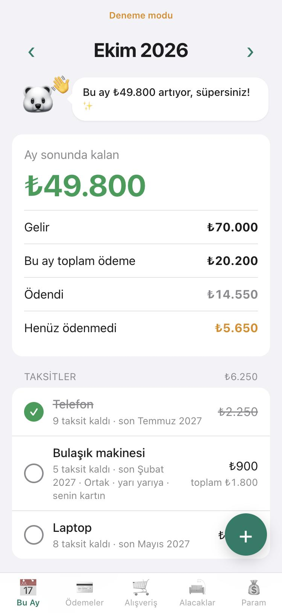
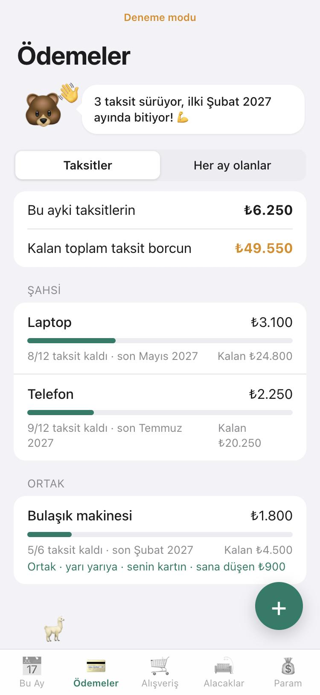
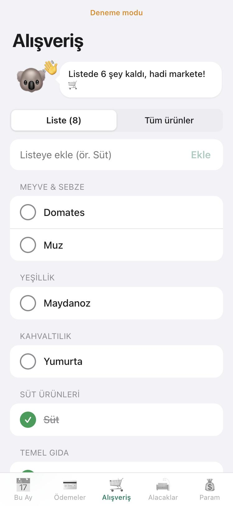
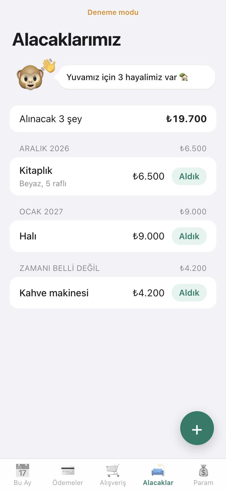
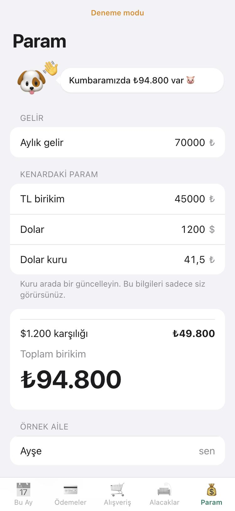

# Aile Bütçesi

İki kişinin birlikte kullandığı, telefona "Ana Ekrana Ekle" ile kurulan bir bütçe uygulaması (PWA).
İleride iOS uygulamasına çevrilecek.

> Ekran görüntülerindeki isimler ve tutarlar tamamen örnektir.

| Bu Ay | Ödemeler | Alışveriş | Alacaklar | Param |
|---|---|---|---|---|
|  |  |  |  |  |

## Özellikler

- **Bu Ay:** gelir − (taksitler + aylık ödemeler + harcamalar) = ay sonunda kalan; ödendi işaretleme, aylar arası gezinme
- **Ödemeler:** taksitler (kaç taksit kaldı, son ay, kalan borç) ve her ay tekrar eden ödemeler
- **Alışveriş:** ~200 hazır ürünlük katalog, tek dokunuşla listeye ekle/çıkar
- **Alacaklar:** ileride alınacak ev eşyaları; "Aldık" deyince peşin/taksitli harcamaya dönüşür
- **Param:** aylık gelir, TL birikim, dolar ve kur (sadece sahibi görür)
- **İki kişi:** şahsi kayıtlar gizli, "ortak alım" işaretlenenler ikisine de yansır (yarı yarıya ya da kart sahibine)
- **Gösterim modu:** başkalarına gösterirken gerçek veriler gizlenir, örnek aile görünür; çıkmak için hesap şifresi gerekir
- **Bildirim:** eş ortak bir şey ekleyince diğer telefona push bildirimi (iOS 16.4+, ana ekrandan açıkken)
- Ekranlarda el sallayan, yemek yiyen, kaka yapan hayvancıklar 🐶💩

## Teknik

- Derleme adımı yok: `index.html` + ES modülleri (Preact + htm, CDN'den)
- Veri: Supabase (Postgres + Row Level Security), `supabase.sql`
- Bildirim: `supabase/functions/notify` (Edge Function, Web Push / VAPID)
- `config.example.js` → `config.js` olarak kopyalanır (repoya girmez). Boşken **deneme modu**: veriler tarayıcıda kalır

Kurulum adımları: [KURULUM.md](KURULUM.md)

```bash
cp config.example.js config.js
python3 -m http.server 8765
```
